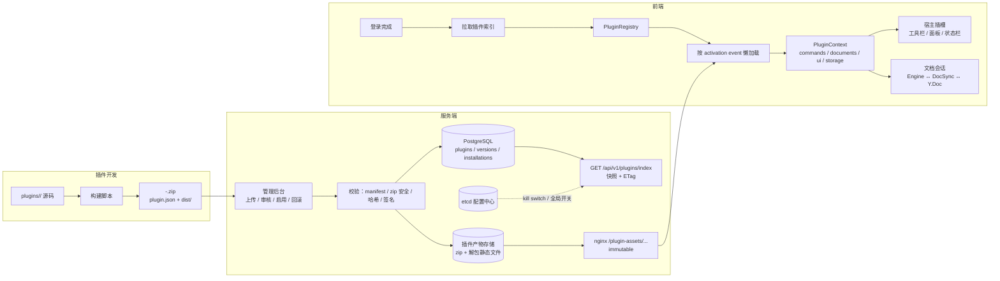
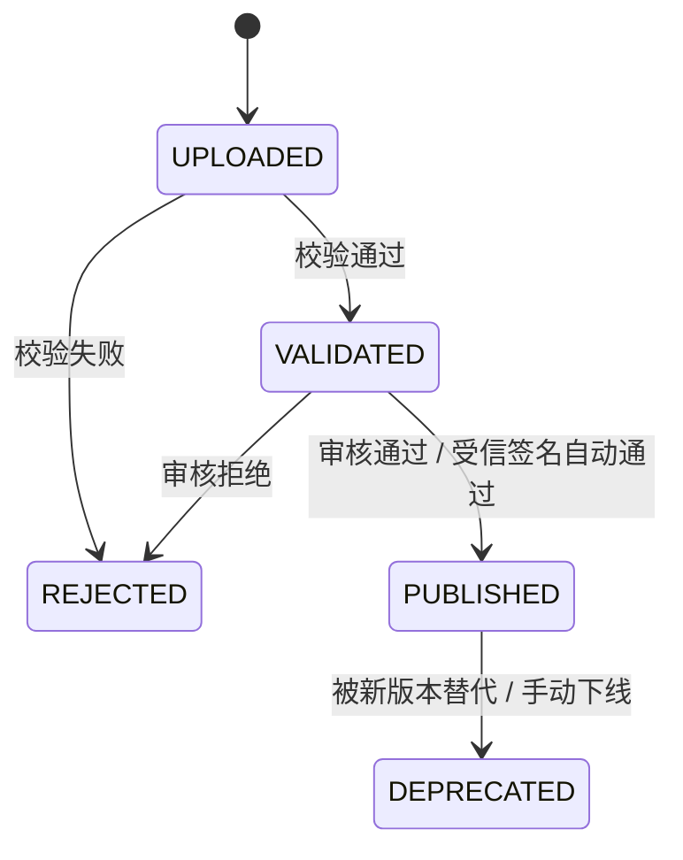
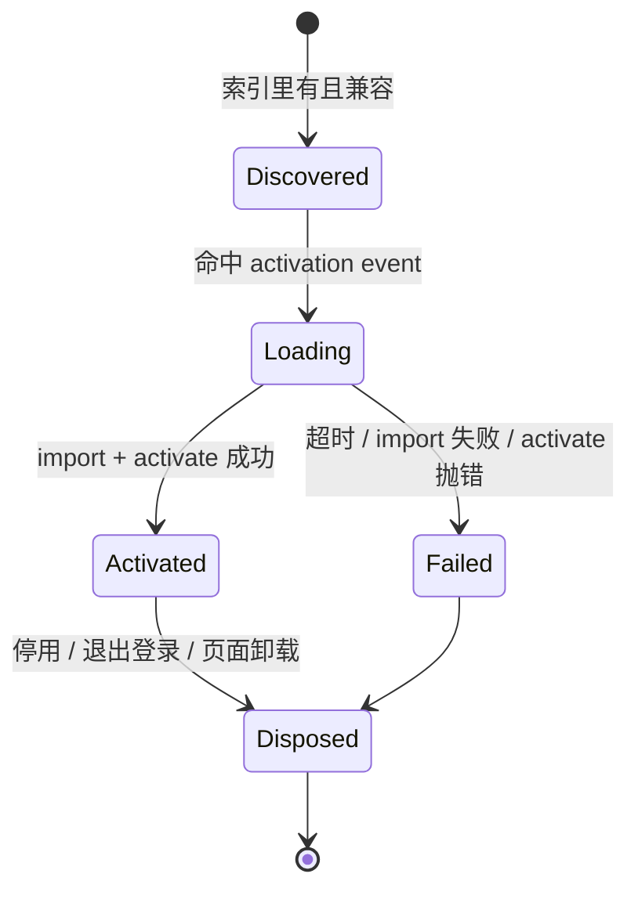
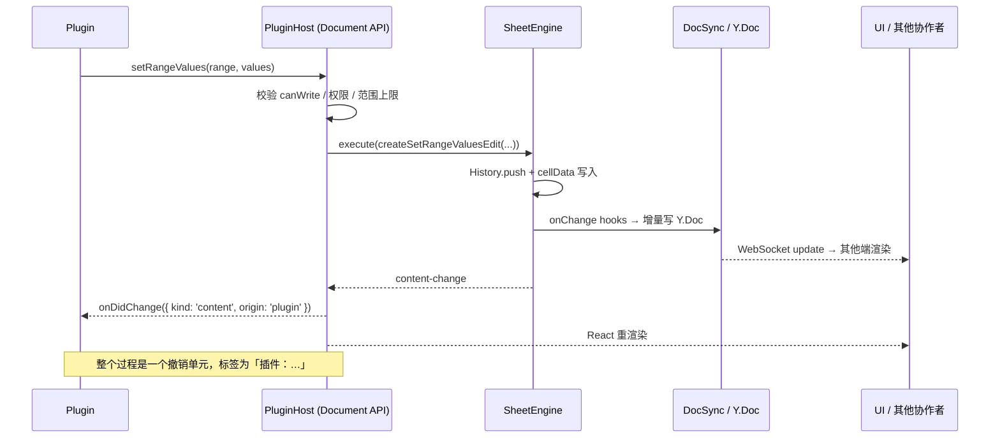

# PgCloudDoc 插件系统设计方案

> 状态：设计稿 v0.1 · 2026-10-31
> 范围：**浏览器端插件（Web Plugin）**。服务端插件、独立文档类型插件、第三方沙箱插件列为后续阶段，理由见第 11 节。
> 基线：前端 React 19 + Vite 6 + antd 6 + Yjs + 自研 canvas 表格引擎；后端 NestJS + Prisma/PostgreSQL + Redis + Kafka + etcd；生产为 nginx 单域部署。

---

## 0. 结论先行

**插件 = manifest（静态声明） + 一份 ESM 代码包 + 宿主提供的版本化能力 API。**

完整链路：

```
插件源码 plugins/<id>/
  → 构建出 <id>-<version>.zip（manifest + dist）
  → 管理端上传 zip
  → 服务端校验、解包、登记版本（DB 为真源，磁盘/对象存储放产物）
  → 客户端登录后拉取「插件索引」（只有 manifest，不含代码）
  → 命中 activation event 时才动态 import 插件 entry
  → activate(context) 拿到受限的 PluginContext（含文档交互 API）
  → 通过 manifest contributions 或运行时 API 把按钮/面板/命令挂到宿主插槽
```

关键决策（与常见误区对照）：

| 决策点 | 本方案 | 不采用 | 原因 |
| --- | --- | --- | --- |
| 代码执行 | 同源 **原生 ESM 动态 import**（可信层） | 浏览器内解 zip 执行 / eval | 相对导入、CSP、缓存、完整性、调试都更顺 |
| 分发 | zip 只作为上传与审计格式，**服务端解包为静态不可变资源** | 前端下载 zip 再解压 | 浏览器端解包无法可靠处理相对 import / 缓存 / 完整性 |
| 清单 | **manifest 声明 + 运行时注册** 混合 | 纯运行时注册 | 未执行代码就能渲染入口、审查权限、按需激活 |
| 下发 | 专用 `GET /api/v1/plugins/index`（DB 为真源，ETag + 快照缓存） | 塞进 etcd 配置中心 | etcd 不适合存二进制、版本历史、事务性安装；单 key 还有 64KB 上限 |
| 宿主 API | **能力受限、异步、版本化 facade**，写入走宿主命令管线 | 直接把 engine / Y.Doc 交给插件 | 否则撤销、协同、只读权限全部失效 |
| 隔离 | 双层信任：v1 可信插件同 realm；第三方插件走 iframe + RPC（后续） | 一律同 realm | 同 realm 的 JS 无法真正沙箱，第三方必须隔离 |
| UI | React 插槽 + 宿主共享 React 实例 | iframe 内自绘 UI | 视觉/主题一致，插件不必打包 React |

---

## 1. 业内先进方案拆解

### 1.1 主流插件体系对比

| 体系 | 分发/安装 | 清单 | 生命周期 | 隔离方式 | 宿主 API |
| --- | --- | --- | --- | --- | --- |
| VS Code | Marketplace / VSIX | `package.json` 的 `contributes` + `activationEvents` + `engines` | 懒激活 `activate(context)`，`context.subscriptions` 统一释放 | **独立 extension host 进程** | 细粒度、版本化的 `vscode` API + Disposable |
| Figma | 插件页面安装 | `manifest.json` + `editorType` | 单文件启动 | **双层 iframe**（UI iframe + 无 DOM 沙箱），RPC | `figma` 全局对象，按 manifest 授权网络 |
| Obsidian | 社区插件市场 | `manifest.json` | `onload` / `onunload` | 无隔离，直接在主页面执行 | 直接操作 app 实例 |
| Grafana | 插件目录 / Catalog | `plugin.json` + `module.js` | 注册、加载、启用 | 后端插件 gRPC 进程；前端 SystemJS 模块 | 版本化 SDK、插件签名 |
| Office Add-ins | AppSource / 侧载 | `manifest.xml` | Office.js 就绪后启动 | **iframe**（开发者域名托管） | Office.js，权限在 manifest |
| Chrome MV3 | Web Store | `manifest.json` + permissions | service worker | **独立扩展 origin + CSP** | 浏览器扩展 API |
| Univer | 编译期集成 | 无（代码内插件） | `onStarting/onReady/onRendered/onDispose` + DI | 同 bundle | 依赖注入 tokens |

### 1.2 所有成熟体系共有的 8 件事

1. **声明式清单**：宿主不执行插件代码就知道它要什么、要挂哪里、需要什么权限。
2. **注册中心 + 版本化分发**：安装、启用、禁用、回滚是服务端能力，不是前端约定。
3. **懒激活**：启动只加载索引，命中 activation event 才执行代码（VS Code 的核心性能设计）。
4. **贡献点（contribution points）**：命令、菜单、工具栏、面板、设置、状态栏都通过宿主定义的插槽扩展。
5. **能力受限的宿主 API**：插件不直接摸内部对象，API 可版本演进、可审计、可按权限裁剪。
6. **生命周期与 Disposable**：所有注册都必须可释放，停用/更新/退出不能留泄漏。
7. **分级隔离**：可信代码可以同进程；不可信代码必须 iframe / Worker / 独立进程。
8. **治理能力**：签名与完整性、人工审核、灰度、kill switch、失败隔离、审计与遥测。

### 1.3 对你当前想法的评估

方向是对的：**zip 分发 + 管理端登记 + 启动下发 + 注册时注入文档 API**，与 Grafana / VS Code 的骨架一致。需要调整 5 点：

1. **启动不要"拉取插件"（下载代码），只拉"插件索引"（manifest）。** 代码按 activation event 懒加载，否则首屏会被插件体积拖垮。
2. **不要在浏览器里解 zip 执行。** zip 是构建与审计产物；服务端解包成静态资源，前端 `import()` 即可。浏览器解包会破坏相对导入、缓存、CSP 与完整性校验。
3. **pluginConfig 不要放 etcd。** 现有配置中心适合开关类小配置；插件注册表需要事务、版本历史、二进制产物、按角色启用，应该是 DB。etcd 只保留全局 kill switch（`plugins.enabled` / `plugins.blocked`）。
4. **"注册时传一个文档交互方法"要升级成能力受限的 facade。** 文档的所有写入必须经过宿主命令管线（`engine.execute` → `History` → change hooks → Y.Doc），否则插件改了数据但撤销栈、协同广播、只读权限全都会错位。
5. **明确信任边界。** 同 realm 的 JS 可以访问 `window`、同源 API、`localStorage`，无法真正沙箱。v1 只允许**平台自己/审核过的插件**同 realm 运行；第三方插件必须走 iframe + RPC 层（第 8.4 节），不能靠"约定不访问"。

---

## 2. 总体架构



### 2.1 分三层职责

| 层 | 职责 | 不做什么 |
| --- | --- | --- |
| 插件产物 | manifest + 纯 ESM 代码 + 静态资源 | 不携带服务端代码、不依赖构建期私有路径 |
| 服务端注册表 | 版本、状态、启用范围、产物存储、索引快照、审计 | 不执行插件代码（v1） |
| 前端插件宿主 | 发现、校验兼容性、加载、激活、贡献点、文档 API、失败隔离 | 不关心插件怎么构建、存在哪个磁盘 |

---

## 3. 插件包规范

### 3.1 源码目录

```
plugins/
  README.MD
  package.json                 # workspace 根：共享 vite 配置、构建脚本
  tsconfig.base.json
  vite.plugin.config.ts        # 统一 externals / 输出格式
  scripts/build-plugin.mjs     # 构建 + 生成 zip + 计算哈希
  csv-tools/                   # 一个插件 = 一个 workspace package
    plugin.json
    package.json
    vite.config.ts
    tsconfig.json
    src/index.tsx
```

建议把 `plugins/*` 和 `packages/*` 加入根 `pnpm-workspace.yaml`，插件可以依赖共享的 `@pgclouddoc/plugin-api`（工作区包，只放类型与 manifest schema）。

### 3.2 zip 结构（不可变版本）

```
csv-tools-1.0.0.zip
  plugin.json
  dist/main.js
  dist/main.css              # 可选
  dist/assets/...            # 代码分割块 / 图标
  README.md
  LICENSE
  plugin.sig                 # 可选：Ed25519 签名
```

约定：

- `plugin.json` 必须在 zip 根目录。
- 一个 `pluginKey + version` **发布后不可覆盖**；重新上传必须升版本（避免缓存与审计混乱）。
- 只允许静态文件扩展名：`.js .mjs .css .json .map .svg .png .jpg .webp .woff2 .txt .md .wasm`；拒绝 `.html`、`.node`、可执行文件（v1 可信层不需要 HTML 入口）。
- 禁止符号链接、绝对路径、`..` 路径、重复文件名。

### 3.3 manifest 示例

```json
{
  "manifestVersion": 1,
  "id": "com.pgclouddoc.csv-tools",
  "name": "CSV 工具",
  "version": "1.0.0",
  "description": "把选区导出为 CSV",
  "author": "PgCloudDoc",
  "entry": "dist/main.js",
  "style": "dist/main.css",
  "engines": {
    "pgclouddoc": ">=1.0.0 <2.0.0",
    "pluginApi": "1"
  },
  "activationEvents": [
    "onDocumentOpen:sheet",
    "onCommand:csvTools.exportSelection"
  ],
  "contributes": {
    "commands": [
      {
        "id": "csvTools.exportSelection",
        "title": "导出选区为 CSV",
        "icon": "dist/icons/export.svg"
      }
    ],
    "toolbar": [
      {
        "slot": "sheet.toolbar.end",
        "command": "csvTools.exportSelection",
        "title": "导出 CSV"
      }
    ],
    "menus": [
      {
        "menu": "sheet.contextMenu",
        "command": "csvTools.exportSelection",
        "group": "export"
      }
    ]
  },
  "permissions": ["document:read"],
  "settings": [
    {
      "key": "delimiter",
      "type": "enum",
      "enum": [",", ";", "\t"],
      "default": ",",
      "title": "CSV 分隔符",
      "scope": "client"
    }
  ]
}
```

### 3.4 字段说明

| 字段 | 必填 | 说明 |
| --- | --- | --- |
| `id` | 是 | 反向域名，全局唯一；`^[a-z0-9][a-z0-9._-]{2,127}$` |
| `version` | 是 | semver；同版本不可覆盖 |
| `entry` | 是 | ESM 入口，相对 zip 根路径 |
| `style` | 否 | 全局样式，宿主在激活时插入 `<link>` |
| `engines.pgclouddoc` | 是 | 宿主版本范围 |
| `engines.pluginApi` | 是 | API 主版本，目前只支持 `"1"` |
| `activationEvents` | 是 | 懒加载触发条件；空数组 = 永不自动激活（只能被命令/视图触发） |
| `contributes` | 否 | 静态贡献点；宿主在插件未激活时也能渲染入口 |
| `permissions` | 否 | 能力声明；管理端在审核页高亮展示 |
| `settings` | 否 | 设置 schema；管理端据此生成表单，值随索引下发（`scope: client`）；`scope: server` 的值永不下发 |
| `icon` | 否 | 插件列表展示用 |

**activation events（v1）**

| 事件 | 触发时机 |
| --- | --- |
| `onStartup` | 登录完成、插件索引就绪后（慎用，会拖慢启动） |
| `onDocumentOpen` | 进入任意文档编辑页 |
| `onDocumentOpen:sheet` | 进入表格文档 |
| `onCommand:<commandId>` | 用户点击 manifest 声明的命令（宿主先激活再执行） |
| `onView:<slotId>` | 用户第一次打开插件贡献的面板 |

> 注意：manifest 里声明的命令可以在未激活时渲染按钮；点击时宿主负责"加载 + 激活 + 执行"。这就是 VS Code 的懒激活模型。

### 3.5 构建约定（共享依赖）

插件不能自带第二份 React（hooks 会直接崩）。统一做法：

- 插件 Vite 配置 `format: 'es'`，`rollupOptions.external` 掉：
  `react`、`react-dom`、`react/jsx-runtime`、`react-dom/client`、`antd`、`@pgclouddoc/plugin-api`。
- 宿主提供 import map（见 5.4），把这些裸导入映射到宿主导出的稳定 runtime 入口。
- 插件构建产物只有一个入口 + 可选 chunk，`base: './'` 保证相对导入。

### 3.6 本地开发模式

```bash
pnpm --filter @pgclouddoc/plugin-csv-tools dev   # vite dev server
```

宿主在 `import.meta.env.DEV` 或显式 `?pluginDev=1` 时读取开发映射：

```ts
// localStorage["pgclouddoc.plugin-dev"] = { "com.pgclouddoc.csv-tools": "http://localhost:5174/" }
```

从开发服务器拉 `plugin.json`，跳过服务端注册表直接加载。生产构建不包含这段发现逻辑（用 `import.meta.env.DEV` 包裹，Vite 会 tree-shake）。

---

## 4. 服务端设计

### 4.1 模块划分

```
backend/src/features/plugins/
  plugins.module.ts
  plugin.controller.ts              # 客户端索引
  plugin-asset.controller.ts        # 开发环境静态服务（生产由 nginx）
  admin-plugin.controller.ts        # 管理端上传/审核/启用/回滚
  plugin-registry.service.ts        # 索引快照、ETag、启用范围解析
  plugin-upload.service.ts          # multipart → 校验 → 解包 → 入库
  plugin-storage.service.ts         # 文件存储抽象（本地盘 / 未来 S3）
  plugin-signature.service.ts       # Ed25519 验签
  manifest.schema.ts                # 复用 @pgclouddoc/plugin-api 的 zod schema
  zip-validator.ts                  # zip 安全校验
  dto/
```

在 `app.module.ts` 注册 `PluginsModule`。

### 4.2 数据模型（Prisma 草案）

```prisma
enum PluginVersionStatus {
  UPLOADED
  VALIDATED
  REJECTED
  PUBLISHED
  DEPRECATED
}

enum PluginScope {
  GLOBAL
  ROLE
  USER
}

model Plugin {
  id            String   @id @default(uuid())
  pluginKey     String   @unique @map("plugin_key")
  name          String
  description   String?
  author        String?
  homepage      String?
  createdBy     String   @map("created_by")
  createdAt     DateTime @default(now()) @map("created_at")

  versions      PluginVersion[]
  installations PluginInstallation[]

  @@map("plugins")
}

model PluginVersion {
  id           String              @id @default(uuid())
  pluginId     String              @map("plugin_id")
  version      String
  manifest     Json
  entry        String
  sha256       String
  signature    String?
  zipBytes     Int                 @map("zip_bytes")
  assetsBytes  Int                 @map("assets_bytes")
  fileCount    Int                 @map("file_count")
  status       PluginVersionStatus @default(UPLOADED)
  pluginApi    String              @map("plugin_api")
  hostRange    String              @map("host_range")
  createdBy    String              @map("created_by")
  createdAt    DateTime            @default(now()) @map("created_at")
  publishedAt  DateTime?           @map("published_at")
  reviewedBy   String?             @map("reviewed_by")
  reviewNote   String?             @map("review_note")

  plugin       Plugin              @relation(fields: [pluginId], references: [id], onDelete: Cascade)
  installations PluginInstallation[]

  @@unique([pluginId, version])
  @@index([status, publishedAt])
  @@map("plugin_versions")
}

model PluginInstallation {
  id              String      @id @default(uuid())
  pluginId        String      @map("plugin_id")
  pluginVersionId String      @map("plugin_version_id")
  scope           PluginScope @default(GLOBAL)
  /// GLOBAL 用空串；ROLE 存角色名；USER 存 userId
  scopeValue      String      @default("") @map("scope_value")
  enabled         Boolean     @default(true)
  settings        Json?
  updatedBy       String      @map("updated_by")
  updatedAt       DateTime    @updatedAt @map("updated_at")

  plugin          Plugin         @relation(fields: [pluginId], references: [id], onDelete: Cascade)
  pluginVersion   PluginVersion  @relation(fields: [pluginVersionId], references: [id])

  @@unique([pluginId, scope, scopeValue])
  @@map("plugin_installations")
}

/// 可选（P2）：插件服务端键值存储
model PluginStorage {
  id         String   @id @default(uuid())
  pluginId   String   @map("plugin_id")
  userId     String   @default("") @map("user_id")
  documentId String   @default("") @map("document_id")
  key        String
  value      Json
  updatedAt  DateTime @updatedAt @map("updated_at")

  @@unique([pluginId, userId, documentId, key])
  @@map("plugin_storage")
}
```

设计说明：

- `Plugin` 是逻辑插件，`PluginVersion` 是不可变版本，`PluginInstallation` 决定"谁在用什么版本"。
- v1 先实现 `GLOBAL` 安装；`ROLE` 用于灰度（先只给管理员），`USER` 用于定向测试。
- 启用解析顺序：`USER` > `ROLE` > `GLOBAL`；同一插件存在更高优先级的禁用记录时以禁用为准。
- `settings` 由管理端按 manifest schema 填写，`scope: server` 的项不进入索引。

### 4.3 存储布局

```
<PLUGIN_STORAGE_DIR>/
  zips/<pluginKey>/<version>.zip              # 原始包，审计/回滚用
  assets/<pluginKey>/<version>/...            # 解包后的静态文件（nginx 只读挂载）
  tmp/<uuid>/                                 # 上传解包临时目录
```

发布流程必须**原子**：解包到 `tmp/` → 校验全部通过 → `rename` 到 `assets/<key>/<version>` → 写 DB。任何一步失败都清理临时目录，不产生半成品。

生产 compose 增加一个 `plugindata` 卷，backend 与 nginx 共享；nginx 以只读方式挂载 `assets/`。

### 4.4 上传校验流水线

服务端不能信 zip 里的任何东西。顺序：

1. **体积限制**：zip ≤ 50MB；解压总量 ≤ 200MB；条目数 ≤ 2000；单文件 ≤ 20MB；总压缩比 ≤ 100:1（防 zip bomb，按流式计数而非先解完）。
2. **路径安全**：拒绝绝对路径、`..`、反斜杠、NUL、符号链接、重复路径、非 UTF-8 文件名；路径长度 ≤ 200。
3. **扩展名白名单**：见 3.2；MIME 由扩展名决定，响应时 `X-Content-Type-Options: nosniff`。
4. **manifest 校验**：`plugin.json` 存在、zod schema 通过、`id/version` 合法、`entry` 存在且是 `.js/.mjs`、`style` 存在（若声明）、`engines.pluginApi` 受支持。
5. **兼容性**：宿主版本满足 `engines.pgclouddoc` 范围；不满足仍可入库，但不可发布。
6. **完整性**：计算 zip 与每个文件的 SHA-256，写入 `PluginVersion.sha256` / manifest 索引。
7. **签名（可选但推荐）**：存在 `plugin.sig` 时用受信公钥验证；签名覆盖 `{pluginKey, version, files: {path: sha256}, entry}` 的 canonical JSON。
8. **静态扫描（可选 P2）**：检测 `eval`、`new Function`、远程 `import("http…")`、可疑域名；只作为审核提示，不作为安全边界。

> 说明：`eval` / 动态代码在可信层是无法从技术上禁止的，所以扫描结果只是审核辅助；真正的安全边界是"只允许可信插件进入同 realm"。

### 4.5 接口设计

**客户端**

| 方法 | 路径 | 鉴权 | 说明 |
| --- | --- | --- | --- |
| `GET` | `/api/v1/plugins/index` | 登录用户 | 返回当前用户可见的插件索引；ETag / 304 |
| `GET` | `/plugin-assets/<pluginKey>/<version>/<path>` | 公开（不可变） | 插件静态文件；生产由 nginx 直出 |
| `POST` | `/api/v1/plugins/telemetry` | 登录用户 | 激活耗时 / 运行时错误（限流、采样） |

**管理端（`AdminGuard`）**

| 方法 | 路径 | 说明 |
| --- | --- | --- |
| `GET` | `/api/v1/admin/plugins` | 插件列表（含最新版本、启用状态） |
| `POST` | `/api/v1/admin/plugins/upload` | multipart zip；校验并创建版本 |
| `GET` | `/api/v1/admin/plugins/:id/versions` | 版本历史 |
| `POST` | `/api/v1/admin/plugins/:id/versions/:version/approve` | 审核通过（可选自动签名免审） |
| `POST` | `/api/v1/admin/plugins/:id/versions/:version/publish` | 发布（设置 installation 指向该版本） |
| `POST` | `/api/v1/admin/plugins/:id/rollback` | 回滚到指定版本 |
| `PUT` | `/api/v1/admin/plugins/:id/installation` | 启用/禁用、作用域、settings |
| `GET` | `/api/v1/admin/plugins/:id/audit` | 审计记录 |
| `GET` | `/api/v1/admin/plugins/:id/versions/:version/download` | 下载原始 zip |

### 4.6 索引响应

```json
{
  "revision": 42,
  "hostApiVersion": "1.0.0",
  "killSwitch": false,
  "plugins": [
    {
      "id": "com.pgclouddoc.csv-tools",
      "version": "1.0.0",
      "baseUrl": "/plugin-assets/com.pgclouddoc.csv-tools/1.0.0/",
      "entry": "dist/main.js",
      "style": "dist/main.css",
      "sha256": "…",
      "engines": { "pgclouddoc": ">=1.4.0 <2.0.0", "pluginApi": "1" },
      "activationEvents": ["onDocumentOpen:sheet", "onCommand:csvTools.exportSelection"],
      "contributes": { "…": "…" },
      "permissions": ["document:read"],
      "settings": { "delimiter": "," }
    }
  ]
}
```

- 只下发**渲染和加载所需的最小字段**；完整 manifest 可通过 `/api/v1/plugins/:id/:version/manifest` 获取（管理页/详情页用）。
- `revision` 取注册表变更序号（DB 最大更新时间或 Redis 计数器），作为 ETag：`ETag: "plugins-42"`。
- 响应头：`Cache-Control: private, max-age=60, must-revalidate`；`Vary: Authorization`（启用范围与用户有关时）。
- 服务端内存快照 + Redis 失效广播：管理端发布/启用后，其他实例最多 60s 内看到；单实例下即时。
- 与 `/api/v1/config` 的关系：**启动级开关**（`plugins.enabled`、`plugins.blocked`）仍走 etcd 配置中心并合并进索引；**插件注册表**永远来自 DB。

### 4.7 发布状态机



规则：

- 同一插件允许多个 `PUBLISHED` 版本，但一个 `installation` 只指向一个。
- 发布不删除旧版本产物（回滚依赖）。
- `DEPRECATED` 版本不允许被新安装，但已安装的仍可运行（可配置强制升级）。

### 4.8 审计与遥测

- 复用现有 `AuditLog`：`action` 用 `plugin.upload / plugin.approve / plugin.publish / plugin.enable / plugin.disable / plugin.rollback`，`resourceType = "plugin"`，`metadata` 记录版本、操作者、IP。
- 客户端遥测（P2）：`plugin.activation`（耗时/成功）、`plugin.error`（消息、堆栈摘要、文档类型）、`plugin.api-denied`。服务端限流 + 采样，落日志或 Kafka，管理页展示"插件健康"。
- 同 realm 插件抛出的未捕获异常难以归因到具体插件；宿主对所有进入插件的入口（activate、命令、事件回调、React slot）做包裹，捕获到的错误带 `pluginId`。

---

## 5. 前端插件宿主

### 5.1 启动顺序

```
loadRuntimeConfig()                     ← 现有逻辑，匿名，首屏前
  → render(<AuthProvider>)
    → 恢复登录态（refresh cookie）
      → PluginHostProvider 初始化
        → GET /api/v1/plugins/index（超时 2s，失败读本地缓存）
        → 过滤：killSwitch / safeMode / engines 不兼容 / 禁用
        → 注册 manifest 贡献点（只渲染入口，不执行插件代码）
        → 触发 onStartup（如有）
      → 进入文档页
        → 挂载文档会话
        → 触发 onDocumentOpen(:sheet)
        → 命中命令/视图时按需激活
```

要点：

- 插件索引**不在** `main.tsx` 的首屏配置里：它需要登录态，而且不应阻塞渲染。
- 索引拉取失败不白屏：使用上次成功的缓存（≤ 24h）；超期则不启用插件，正常打开文档。
- **退出登录必须 dispose 全部插件并清空内存态**。更保守的做法是退出后整页刷新，确保插件模块作用域里的用户数据不残留。

### 5.2 目录结构

```
frontend/src/app/plugins/
  host/
    PluginHostProvider.tsx      # React Provider（登录态驱动初始化/销毁）
    plugin-manager.ts           # 状态机、激活/停用、事件分发
    plugin-registry.ts          # 索引拉取、缓存、兼容性过滤
    plugin-loader.ts            # 动态 import、样式注入、超时、失败处理
    activation-events.ts
    document-sessions.ts        # 文档会话注册中心
  api/
    context.ts                  # PluginContext 构造
    commands.ts
    documents.ts                # DocumentHub + SheetDocumentApi
    ui.ts                       # 运行时贡献注册
    storage.ts
    settings.ts
    logger.ts
    version.ts                  # 宿主 API 版本
  ui/
    PluginSlot.tsx              # 插槽渲染 + ErrorBoundary
    PluginErrorBoundary.tsx
    contributions.tsx           # manifest 贡献 → React 节点
  telemetry.ts
  types.ts
```

共享类型与 manifest schema 在 `packages/plugin-api/`，前端/后端/插件三方共用一份。

### 5.3 插件状态机



实现要点：

- `Loading` 期间同一个插件只允许一次 import（Promise 去重）。
- 激活超时 10s；超时后标记失败，不阻塞其他插件。
- 命令执行、面板渲染、事件回调都包 `try/catch`；连续失败 N 次的插件自动停用（客户端熔断），并上报。
- 一个插件的失败不能影响宿主或其他插件；插件贡献的 React 节点各自有 ErrorBoundary。

### 5.4 代码加载与共享依赖

**加载**

```ts
const mod = await import(/* @vite-ignore */ `${baseUrl}${entry}`);
```

- `/* @vite-ignore */` 阻止 Vite 在构建时尝试解析运行时 URL。
- 样式：激活时插入 `<link rel="stylesheet" href={baseUrl + style}>`，插件停用时移除。
- 超时：`Promise.race` + 计时器；import 失败后缓存失败状态，避免每次命令都重试（可手动重试）。

**共享 React（关键）**

插件 bundle 里不能有第二份 React。宿主在 `index.html` 写静态 import map：

```html
<script type="importmap">
{
  "imports": {
    "react": "/plugin-runtime/react.js",
    "react/jsx-runtime": "/plugin-runtime/jsx-runtime.js",
    "react-dom": "/plugin-runtime/react-dom.js",
    "react-dom/client": "/plugin-runtime/react-dom-client.js",
    "antd": "/plugin-runtime/antd.js",
    "@pgclouddoc/plugin-api": "/plugin-runtime/plugin-api.js"
  }
}
</script>
```

这些 `/plugin-runtime/*.js` 是宿主构建产物中的**稳定文件名入口**，它们 `export * from` 宿主同一个 React/antd 实例：

- Vite/Rollup 同一次构建里，`plugin-runtime` 入口与主应用会共享同一个 React vendor chunk（模块按 URL 只实例化一次），所以 hooks 正常。
- 构建配置需要为 runtime 入口固定 `entryFileNames`（例如 `plugin-runtime/[name].js`），并保证它引用的是共享 chunk 而不是内联复制。
- runtime 入口文件很小，响应头 `Cache-Control: no-cache`（或极短 max-age），发版后立即更新；插件静态资源才是 `immutable`。
- **必须有一个冒烟测试**：在示例插件里调用 `React.useState` 并断言 `React.version === hostReact.version`；一旦 Vite 升级导致产物结构变化，这个测试会先炸。

> 如果这套 import map 方案在 Vite 升级中反复踩坑，备选是 Grafana 的 SystemJS 模块注册表（显式模块名 + 依赖映射），代价是多一个运行时、少一点原生感。设计上把"共享依赖如何注入"封装在 loader 里，插件代码不受影响。

### 5.5 贡献点与插槽

**manifest 贡献（静态）**：宿主在插件未激活时就能渲染占位/按钮；点击命令时再激活。适合稳定的入口。

**运行时注册（动态）**：`context.ui.registerToolbarItem()` 等，用于根据文档内容动态出现的按钮。所有注册返回 `Disposable`，自动进入 `context.subscriptions`。

v1 插槽清单：

| 插槽 | 位置 | 形态 |
| --- | --- | --- |
| `editor.titleBar.start` / `.end` | 编辑器标题栏 | 图标按钮 / 小组件 |
| `sheet.toolbar.start` / `.end` | 表格工具栏两端 | 按钮、下拉菜单 |
| `sheet.statusBar.start` / `.end` | 状态栏 | 文本 / 小按钮 |
| `sheet.contextMenu` | 单元格右键菜单 | 菜单项 |
| `editor.sidebar` | 编辑器右侧面板（宿主级容器，见 5.5.1） | 插件容器面板 |
| `documents.list.header` | 文档列表页顶部（P2） | 按钮 |

插槽渲染：

```tsx
<PluginSlot name="sheet.toolbar.end" documentId={documentId} />
```

宿主按注册顺序渲染，每个条目用 `key={pluginId + itemId}` 包 ErrorBoundary；`readOnly` 文档下宿主可以按贡献的 `requiresWrite` 自动禁用。

#### 5.5.1 侧面板是宿主固有能力

右侧面板不归插件系统所有，而是宿主的基础设施（`frontend/src/shared/side-panel`）：

- **一个容器**：活动栏 + 标题栏 + 内容区，可拖拽改宽、可整体收起，宽度与开合状态持久化到 `localStorage`。
- **一个 store**：宿主页面和插件宿主往同一张视图表里注册，显示的始终只有一个视图。
- **两种内容形态**：
  - 宿主页面用 `render: () => ReactNode`（`useSidePanelView` / `sidePanel.register`），页面卸载时自动注销；
  - 插件用 `mount(container)` 容器挂载。宿主的共享 React 运行时（import map）尚未落地，容器挂载让插件零运行时依赖，同时是后续 iframe + RPC 隔离模型的同一套接缝。
- **显隐接口**：`show/hide/toggle/activate` 在宿主侧；插件侧对应 `ui.showPanel` / `ui.hidePanel` / `ui.isPanelVisible`。
- **懒激活**：manifest `contributes.panels` 只登记元信息，宿主先放占位视图；用户打开时触发 `onView:<id>`，插件激活后用同 id 的 `registerPanel` 替换内容。
- **失败隔离**：每个视图独立 ErrorBoundary；插件挂载抛错只影响该面板，活动栏和其他视图照常工作。

### 5.6 文档会话桥

这是插件系统与现有编辑器唯一的强耦合点，必须做窄。

```ts
export interface DocumentSession {
  id: string;
  type: 'sheet';
  engine: SheetEngine;
  /** 角色确认前的竞态：canEdit 为 false 时一律按只读处理 */
  canWrite(): boolean;
  materialize(): IWorkbookData;
  onDispose(cb: () => void): () => void;
}
```

接入点：

- `EditorPage` 在 `handleEngineReady(engine)` 里调用 `pluginHost.attachDocument({...})`；在清理函数里 `detachDocument(id)`。
- 角色是异步加载的（`myRole` 初始为 `null`）。宿主 `canWrite()` 必须复用现有语义：**只有 `OWNER/EDITOR` 且引擎非只读才允许写**；`null` 期间按只读拒绝，绝不能因为"还没拉到角色"而放行。
- 卸载/结构重建（`structureVersion` 变化）时先 detach 再 attach，插件通过 `onDidChange` 感知重建，不保留旧 engine 引用。

### 5.7 失败隔离与安全模式

- 每个插件的激活、命令、事件、UI 都有边界捕获。
- **安全模式**：`?safe=1` 或 `localStorage["pgclouddoc.plugins.disabled"]=1` 启动时不加载任何插件。这是同 realm 插件体系必备的逃生通道（插件死循环/白屏时能进系统）。
- **服务端 kill switch**：etcd `plugins.enabled=false` 或 `plugins.blocked=["id"]`，索引返回 `killSwitch` 或过滤插件；管理端禁用后最多一个索引周期生效。
- **同 realm 的硬限制**：同步死循环无法被宿主抢占，只能靠审核 + 熔断 + 安全模式 + 后续沙箱层。文档里必须明确这一点，不能对外承诺"插件崩了不影响主程序"。

### 5.8 缓存与更新语义

- 索引：ETag 协商 + `localStorage` 缓存（含 revision、时间戳）。
- 插件资源：URL 含 `pluginKey/version`，响应 `immutable`；新版本 = 新 URL，不存在缓存污染。
- **ESM 无法卸载**：已加载的模块代码会一直留在页面里。因此版本更新策略是：
  - 已在运行的文档会话继续用旧版本（索引在会话开始时固定）；
  - 新打开的文档用新版本；
  - 重新加载页面后全部生效。
- 插件停用：释放所有 subscriptions、移除 UI、卸载样式、关闭文档 API；模块作用域内的副作用无法回收（同上，如实记录在开发文档）。

---

## 6. 插件 API v1

### 6.1 PluginContext

```ts
export type Disposable = { dispose(): void };

export interface PluginContext {
  readonly pluginId: string;
  readonly pluginVersion: string;
  readonly hostVersion: string;
  readonly apiVersion: '1';

  readonly logger: PluginLogger;
  readonly commands: CommandApi;
  readonly documents: DocumentHub;
  readonly ui: UiApi;
  readonly settings: SettingsApi;
  readonly storage: StorageApi;

  /** 所有注册/监听都放进来，宿主停用时统一 dispose */
  readonly subscriptions: Disposable[];

  hasPermission(permission: PluginPermission): boolean;
}

export interface PluginModule {
  activate(context: PluginContext): void | Promise<void>;
  deactivate?(): void | Promise<void>;
}
```

插件入口：

```ts
// dist/main.js 由 Vite 输出为 ESM，导出 activate
export async function activate(ctx: PluginContext) { … }
export function deactivate() { … }
```

### 6.2 文档 API

```ts
export interface DocumentHub {
  /** 当前打开的文档；不在编辑页时为 null */
  active(): SheetDocumentApi | null;
  onDidOpen(cb: (doc: SheetDocumentApi) => void): Disposable;
  onDidClose(cb: (documentId: string) => void): Disposable;
}

export interface SheetDocumentApi {
  readonly id: string;
  readonly title: string;
  readonly type: 'sheet';
  readonly readOnly: boolean;
  readonly canWrite: boolean;

  // ── 读 ──
  getSelection(): SelectionSnapshot;
  setSelection(selection: SelectionSnapshot): Promise<void>;
  getSheets(): SheetSummary[];
  getActiveSheetId(): string;
  setActiveSheet(sheetId: string): Promise<void>;
  /** 上限 20,000 格；超过直接抛 E_PLUGIN_RANGE_TOO_LARGE */
  getRangeValues(range: RangeSnapshot): Promise<CellSnapshot[][]>;
  /** 只读深拷贝；大文档慎用，建议只读选区 */
  getSnapshot(): Promise<WorkbookSnapshot>;

  // ── 写（全部走宿主命令管线） ──
  setRangeValues(range: RangeSnapshot, values: CellInput[][]): Promise<void>;
  clearRange(range: RangeSnapshot): Promise<void>;
  setRangeStyle(range: RangeSnapshot, patch: StylePatch): Promise<void>;

  // ── 事件 ──
  onDidChange(cb: (event: DocumentChangeEvent) => void): Disposable;
  onDidChangeSelection(cb: (event: SelectionChangeEvent) => void): Disposable;

  // ── 事务：多次写入合成一次撤销 ──
  transact<T>(label: string, fn: (tx: DocumentTransaction) => Promise<T> | T): Promise<T>;
}

export interface DocumentTransaction {
  setRangeValues(range: RangeSnapshot, values: CellInput[][]): void;
  clearRange(range: RangeSnapshot): void;
  setRangeStyle(range: RangeSnapshot, patch: StylePatch): void;
}
```

**为什么所有方法都返回 Promise**：v1 是同步实现，但 API 形态必须先异步化。否则将来把某个插件放进 iframe/Worker 时，函数签名全要变，插件生态直接断代。

**数据形态**：只返回普通 JSON（`{ value, formula, displayText, style? }`），不返回 `ICellData`、`Worksheet`、`Y.Doc` 或任何引擎内部对象。这既避免插件依赖内部实现，也让沙箱 RPC 可以原样复用同一套类型。

### 6.3 写入语义（最关键的一段）

插件写单元格的完整路径：

```
plugin.setRangeValues()
  → 宿主校验：会话存在 / canWrite / 范围合法 / 单元格数上限
  → 构造 createSetRangeValuesEdit(worksheet, range, matrix, "插件：…")
  → engine.execute(edit)
      → history.push(edit)               ← 一次撤销单元
      → cellData 变更触发 onChange 钩子
      → DocSync 把增量写进 Y.Doc          ← 协同广播
      → engine 发 content-change
  → 插件 onDidChange、React UI、其他协作者同时收到变更
```

规则：

1. **禁止插件直接改 `engine.workbook` / `worksheet.cellData` / Y.Doc。** 绕过 `engine.execute` 的写入不会进撤销栈，也会因为 DocSync 的本地 origin 机制而不同步。
2. **一次 API 调用 = 一个撤销单元。** `transact` 把多次写入合成一个 composite `IEdit`，用户按一次 Ctrl+Z 整体回退。
3. **写的标签带插件名**：`"插件：CSV 工具 - 导入"`，出现在"撤销 xxx"提示里，便于用户理解。
4. **只读拦截在宿主层做两次**：`readOnly` 文档直接抛 `E_PLUGIN_READ_ONLY`；引擎自身的 `readOnly` 仍然兜底。
5. **结构操作（增删/重命名工作表）v1 不开放写接口。** 现有 `addSheet/removeSheet/renameSheet` 没有进入 `History`，暴露出去会破坏"撤销"语义。等引擎补上结构型 `IEdit` 后再开放（见 10 节）。
6. **写入串行化**：同一文档上的插件写操作进入队列，避免两个插件的事务交叉；单次调用内部仍同步完成。
7. **大范围写入限制**：单次 ≤ 20,000 格；超过请分批并显式 `transact`，否则页面会卡。

### 6.4 命令、UI、设置、存储

```ts
export interface CommandApi {
  register(id: string, handler: (...args: unknown[]) => unknown): Disposable;
  execute<T = unknown>(id: string, ...args: unknown[]): Promise<T>;
}

export interface UiApi {
  registerToolbarItem(item: ToolbarItem): Disposable;
  registerMenuItem(item: MenuItem): Disposable;
  registerStatusBarItem(item: StatusBarItem): Disposable;
  registerPanel(panel: PanelContribution): Disposable;
  showMessage(level: 'info' | 'success' | 'warning' | 'error', message: string): void;
}

export interface SettingsApi {
  get<T>(key: string): T;                 // manifest 默认值 + 管理端覆盖
  onChange(cb: (key: string, value: unknown) => void): Disposable;
}

export interface StorageApi {
  get<T>(key: string): Promise<T | null>;
  set<T>(key: string, value: T): Promise<void>;
  delete(key: string): Promise<void>;
  keys(): Promise<string[]>;
}
```

- 设置值来自索引里的 `settings`；`scope: server` 项不会出现在客户端。
- v1 的 `storage` 落在 `localStorage`，命名空间 `pgclouddoc.plugin.<pluginId>.<userId>.<key>`，单插件配额 1MB，JSON 序列化；后续可无缝替换为服务端 `PluginStorage`。
- `showMessage` 走宿主 antd 的 `App.useApp()` 实例，保证主题/上下文一致；插件不应自己 import antd 的静态 `message`。

### 6.5 权限与错误

```ts
export type PluginPermission =
  | 'document:read'
  | 'document:write'
  | 'document:structural'   // 预留
  | 'storage'
  | 'clipboard:write'
  | 'notifications';
```

**v1 的实际强制力**：

- `document:read` / `document:write` / `storage`：宿主在 API 入口强制检查，缺失直接抛 `E_PLUGIN_PERMISSION`。
- UI 贡献：由 manifest 审核控制；运行时注册不做细粒度权限（同 realm 插件本来就能操作 DOM）。
- 网络访问：同 realm 无法限制，插件可以用 `fetch` 调用同源 API。**这是可信层的固有代价**；第三方插件必须进沙箱层，届时由 iframe 的 CSP 限制 `connect-src`。
- 管理端审核页必须把 `permissions` 和"同 realm 运行"的风险提示放在显眼位置。

错误模型：

```ts
export class PluginApiError extends Error {
  constructor(
    readonly code:
      | 'E_PLUGIN_READ_ONLY'
      | 'E_PLUGIN_PERMISSION'
      | 'E_PLUGIN_RANGE_TOO_LARGE'
      | 'E_PLUGIN_INVALID_RANGE'
      | 'E_PLUGIN_NO_DOCUMENT'
      | 'E_PLUGIN_DISPOSED',
    message: string
  ) { super(message); }
}
```

### 6.6 API 设计规则（写进插件开发文档）

1. 所有文档操作异步；插件代码从第一天就按异步写。
2. 只依赖 `@pgclouddoc/plugin-api` 的类型，不 import 宿主内部模块（`spreadsheet/engine`、`collab/*`）。
3. 任何注册/监听都 push 到 `context.subscriptions`；`deactivate` 里不要手动做宿主已经代劳的事。
4. 不在模块顶层持有文档/用户数据（模块不会因停用而卸载）。
5. 长任务（> 50ms）放 `setTimeout` / `requestIdleCallback` 分片，避免阻塞输入。
6. 插件 API 主版本内只做加法；破坏性变更升 `pluginApi` 主版本，宿主至少并行支持一个旧主版本。

---

## 7. 示例插件（CSV 工具）

```json
// plugins/csv-tools/plugin.json
{
  "manifestVersion": 1,
  "id": "com.pgclouddoc.csv-tools",
  "name": "CSV 工具",
  "version": "1.0.0",
  "entry": "dist/main.js",
  "engines": { "pgclouddoc": ">=1.4.0 <2.0.0", "pluginApi": "1" },
  "activationEvents": ["onCommand:csvTools.exportSelection"],
  "contributes": {
    "commands": [{ "id": "csvTools.exportSelection", "title": "导出选区为 CSV" }],
    "toolbar": [
      { "slot": "sheet.toolbar.end", "command": "csvTools.exportSelection", "title": "导出 CSV" }
    ]
  },
  "permissions": ["document:read"],
  "settings": [
    { "key": "delimiter", "type": "enum", "enum": [",", ";"], "default": ",", "scope": "client" }
  ]
}
```

```tsx
// plugins/csv-tools/src/index.tsx
import type { PluginContext } from '@pgclouddoc/plugin-api';

export async function activate(ctx: PluginContext) {
  const { commands, documents, settings, ui, subscriptions } = ctx;

  subscriptions.push(
    commands.register('csvTools.exportSelection', async () => {
      const doc = documents.active();
      if (!doc) throw new Error('当前没有打开的文档');

      const selection = doc.getSelection();
      if (!selection.ranges.length) {
        ui.showMessage('warning', '请先选择要导出的区域');
        return;
      }

      const rows = await doc.getRangeValues(selection.ranges[0]);
      const delimiter = settings.get<string>('delimiter') ?? ',';
      const csv = rows
        .map((row) => row.map((cell) => escapeCsv(cell.displayText, delimiter)).join(delimiter))
        .join('\r\n');

      download(new Blob([`${csv}`], { type: 'text/csv;charset=utf-8' }), 'selection.csv');
      ui.showMessage('success', `已导出 ${rows.length} 行`);
    })
  );
}

function escapeCsv(value: string, delimiter: string): string {
  return value.includes(delimiter) || /["\r\n]/.test(value)
    ? `"${value.replace(/"/g, '""')}"`
    : value;
}

function download(blob: Blob, filename: string) {
  const url = URL.createObjectURL(blob);
  const a = document.createElement('a');
  a.href = url;
  a.download = filename;
  a.click();
  URL.revokeObjectURL(url);
}
```

这个例子覆盖了：manifest 声明入口 → 懒激活 → 命令 → 文档读取 → 设置 → 宿主通知。写操作的版本只需把 `getRangeValues` 换成 `setRangeValues` 并在 manifest 加 `document:write`。

---

## 8. 安全与治理

### 8.1 威胁模型

| 威胁 | 影响 | 对策 |
| --- | --- | --- |
| 恶意插件读取/篡改文档 | 数据泄露/损坏 | v1 只允许可信插件；API 能力裁剪；审核；第三方走沙箱 |
| 插件调用同源 API（携带用户 cookie） | 越权操作 | 同 realm 无法技术阻断；靠审核 + 沙箱层；后端接口本身仍做权限校验 |
| 上传恶意 zip | RCE / 磁盘打满 / 路径穿越 | zip 校验流水线；只解包不执行；存储目录与代码分离 |
| 产物被篡改 | 供应链攻击 | 每文件 SHA-256 + 可选签名 + 不可变 URL |
| 管理员账号被盗 | 发布恶意插件 | 签名要求（自动发布必须签名）、审计、二次确认、最小化管理员权限 |
| 插件死循环 / 崩溃 | 页面卡死 | 安全模式、熔断、kill switch；第三方沙箱可终止 |
| 插件存储滥用 | 浏览器配额 | 单插件 1MB、命名空间隔离、退出清理 |

### 8.2 同 realm 的诚实边界

v1 的"可信插件"本质是**平台代码的运行时扩展**，不是安全沙箱。任何声称"in-realm 但限制插件访问网络/DOM"的方案都是不成立的。因此：

- 只允许管理员上传、且经过审核的插件进入 `trusted` 通道；
- 管理端明确展示"该插件将以平台权限运行"；
- 第三方/市场插件从第一天就设计为 `sandboxed` 通道，不允许通过配置降级到 `trusted`。

### 8.3 CSP 与响应头

生产 nginx 目前没有 CSP（前端是 SPA，样式由 antd 内联）。引入插件后建议：

```nginx
# 前端页面
add_header Content-Security-Policy "default-src 'self'; script-src 'self'; style-src 'self' 'unsafe-inline'; img-src 'self' data: blob:; font-src 'self' data:; connect-src 'self' ws: wss:; frame-src 'self'" always;

# 插件静态资源
location /plugin-assets/ {
    root /var/lib/pgclouddoc/plugin-assets;
    expires 1y;
    add_header Cache-Control "public, max-age=31536000, immutable" always;
    add_header X-Content-Type-Options nosniff always;
    # location 内 add_header 会覆盖 server 级配置，安全头需要在这里重复或 include
}
```

- `script-src 'self'` 允许同源 ESM（插件），同时挡住远程脚本注入。
- 如果使用内联 `importmap` 脚本，需要 `script-src 'self' 'unsafe-inline'` 或给 importmap 加 nonce/hash。更稳的做法是给 importmap 一个固定的 hash 或由服务端注入 nonce。
- 第三方沙箱层：独立 origin（或至少 `sandbox="allow-scripts"` 的 opaque origin）+ iframe 响应自己的 CSP（默认 `connect-src 'none'`，按权限放开）。

### 8.4 第三方沙箱（P4 设计预留）

```
host page
  └─ <iframe sandbox="allow-scripts" src="/plugin-sandbox/<id>/<version>/index.html">
       ├─ 插件 UI（自带 React 或原生 DOM）
       └─ postMessage RPC ──→ 宿主 PluginSandboxBridge
                               ├─ 能力检查（按 manifest permissions）
                               ├─ 文档 API（复用同一套 DocumentHub 接口）
                               └─ 超时 / 请求 id / 取消
```

- RPC 消息必须带 `requestId`、`pluginId`、`apiVersion`，宿主校验来源 `event.origin`（独立 origin 时）。
- 每次调用有超时（5s）；宿主可随时销毁 iframe 终止插件。
- 文档读取返回结构化克隆的纯 JSON；写入走同一套命令管线。
- 网络访问由 iframe 的 CSP 控制，而不是"信任插件"。
- 这一层的实现可以复用第 6 节的接口定义，这也是 API 从第一天就异步化的原因。

### 8.5 供应链

- 插件构建使用锁文件；zip 由 CI 生成，可复现。
- 可选 `plugin.sig`：CI 用 Ed25519 私钥签名，服务端用 `PLUGIN_TRUSTED_KEYS` 公钥验签。
- 生产环境不加载远程 CDN 依赖；插件 bundle 自包含（除宿主共享依赖）。
- 保留原始 zip 与每个文件哈希，支持事后审计。

---

## 9. 版本、灰度、回滚、可观测

### 9.1 版本策略

| 对象 | 规则 |
| --- | --- |
| 宿主 API | 主版本 `1`；同一主版本只做加法；弃用项至少保留一个大版本 |
| 插件版本 | semver；发布后不可变；同一 `pluginKey` 可并行存在多个版本 |
| manifest | `manifestVersion` 独立演进；服务端拒绝不认识的版本 |
| 引擎兼容 | `engines.pgclouddoc` 使用 semver range；不满足直接不加载并在管理端标记 |

### 9.2 灰度与回滚

1. 上传 → 校验 → 审核。
2. 先建 `ROLE=ADMIN` 的 installation，管理员自己先用。
3. 观察遥测（激活失败率、报错率）后切 `GLOBAL`。
4. 出问题：管理端把 installation 指回旧版本（回滚）或禁用；紧急情况用 etcd kill switch。
5. 旧版本产物保留；`DEPRECATED` 只影响新安装。

### 9.3 可观测性

- 服务端：上传/发布/启用操作进 `AuditLog`；索引接口记录耗时与 revision。
- 客户端：激活耗时、失败原因、API 拒绝、未捕获错误；批量上报（`fetch keepalive` 或 `sendBeacon`）。
- 管理页：每个插件的版本、启用范围、最近错误、激活成功率；「一键禁用」。
- 目标指标：插件导致的页面崩溃/白屏次数为 0（靠安全模式兜底）、索引接口 P99 < 50ms、单插件激活 P95 < 300ms。

---

## 10. 与现有代码的接入点

| 位置 | 改动 |
| --- | --- |
| `pnpm-workspace.yaml` | 增加 `packages/*`、`plugins/*` |
| `packages/plugin-api/` | 新建：类型、manifest zod schema、API 版本常量；构建出 `dist/`，后端/前端/插件共用 |
| `plugins/` | 新增共享构建配置、构建脚本、示例插件；补充 `plugins/README.MD` |
| `frontend/index.html` | 增加静态 import map（指向 `/plugin-runtime/*.js`） |
| `frontend/vite.config.ts` | 增加 `plugin-runtime` 入口、稳定文件名、共享 chunk 配置 |
| `frontend/src/main.tsx` | 不改启动顺序；插件初始化放在登录之后 |
| `frontend/src/App.tsx` | `AuthProvider` 内包 `PluginHostProvider`；新增 `/admin/plugins` 懒加载路由 |
| `frontend/src/app/editor/EditorPage.tsx` | `handleEngineReady` 里 attach/detach 文档会话；标题栏放 `PluginSlot` |
| `frontend/src/app/editor/CollaboratorsPopover.tsx` 附近 | 可放 `editor.titleBar` 插件入口 |
| `frontend/src/app/spreadsheet/SheetView.tsx` | `Toolbar` 两端、`StatusBar` 两端插入 `PluginSlot`（或通过 props 注入） |
| `frontend/src/app/spreadsheet/ui/Toolbar.tsx` | 末尾渲染 `sheet.toolbar.end` 插槽 |
| `frontend/src/app/spreadsheet/ui/StatusBar.tsx` | 渲染 `sheet.statusBar.end` 插槽 |
| `frontend/src/app/spreadsheet/engine/index.ts` | 加固：`exposeGlobal` 默认改 `false`（生产）；后续补结构型 `IEdit` |
| `frontend/src/app/admin/AdminConfigPage.tsx` | 旁边新增插件管理页/入口 |
| `backend/prisma/schema.prisma` | 新增 `Plugin*` 模型与 migration |
| `backend/src/app.module.ts` | 注册 `PluginsModule` |
| `backend/.env.example` / `deploy/.env.production.example` | 新增 `PLUGIN_STORAGE_DIR`、`PLUGIN_MAX_ZIP_BYTES`、`PLUGIN_TRUSTED_KEYS` |
| `deploy/docker-compose.prod.yml` | 新增 `plugindata` 卷，挂载到 backend 与 nginx |
| `deploy/nginx.conf` | 新增 `/plugin-assets/` 静态服务与 CSP |
| `backend/src/features/config-center` | 新增客户端配置键 `plugins.enabled`、`plugins.blocked` |

> 关于 `exposeGlobal`：`SheetEngine` 构造函数目前默认把实例挂到 `window.__sheetEngine`。同 realm 插件可以直接拿它绕过所有 API 约束。生产环境应默认关闭，只在开发/压测时通过选项打开。

---

## 11. 边界与后续阶段

### 11.1 v1 明确不做

| 不做 | 原因 | 后续 |
| --- | --- | --- |
| 第三方不可信插件同 realm 运行 | 无法沙箱 | P4 iframe + RPC |
| 服务端 Node 插件（导入/导出格式、定时任务） | 任意 Node 代码 = 宿主完全失守；必须独立进程/容器 + 资源限制 | P4/P5 |
| 插件自定义文档类型/渲染器 | 当前文档模型与渲染强绑定表格；需要先抽象文档类型注册 | 独立项目 |
| 结构化写操作（增删 sheet） | 引擎尚未把结构变更纳入撤销/协同事务 | 引擎补 `IEdit` 后开放 |
| 插件市场/在线安装 | 企业内先做管理端上传 | 有需求再做 |
| 插件间互相调用 | 依赖关系复杂，先禁止 | 通过命令总线的显式依赖声明 |

### 11.2 为什么服务端插件要单独设计

现有 `documents/formats` 已经把文件格式做成注册表，看起来很适合插件化。但服务端插件拿到的是 Node 进程权限（文件系统、数据库连接、内网），风险远高于浏览器插件。正确做法是：

- 独立 worker 进程 / 容器，只暴露格式解析所需的最小接口（Buffer 进、Snapshot 出）；
- 资源限制（CPU/内存/超时）、无网络、只读挂载；
- 与 Web 插件共用 manifest 的 `id/version/permissions` 概念，但走独立的运行时和审核流程。

在完成这套隔离之前，不建议开放服务端插件。

---

## 12. 实施计划

| 阶段 | 交付物 | 验收标准 |
| --- | --- | --- |
| **P0 协议先行**（2–3 天） | `packages/plugin-api` 类型 + manifest schema；`plugins/` 构建脚本；`example-hello` 插件；前端 host 骨架 + dev loader | 本地 dev 模式能加载示例插件、注册工具栏按钮、读取选区 |
| **P1 服务端注册表**（4–6 天） | Prisma 模型 + 迁移；上传/校验/解包/存储；索引接口；管理端 API；nginx 静态服务 | 上传 zip → 审核 → 启用 → 客户端索引可见；恶意 zip 全部被拒 |
| **P2 宿主完整能力**（5–7 天） | 索引缓存/ETag；懒激活；贡献点与插槽；DocumentHub + 写 API；错误隔离；安全模式；设置/存储 | 示例插件可读可写；一次插件写入 = 一次撤销 = 协作者实时可见；只读用户写入被拒 |
| **P3 治理与运维**（3–4 天） | 管理端插件页面；审计；kill switch；遥测与健康；签名；灰度/回滚 | 管理端可上传/审核/启用/回滚；禁用后新页面不再加载；错误可观测 |
| **P4 沙箱层**（按需） | iframe 沙箱 + RPC bridge + 独立 origin + CSP | 不可信插件无法访问宿主 DOM/cookie/网络（除授权）；可被强制终止 |
| **P5 服务端插件**（按需） | worker/容器隔离 + 格式解析接口 | 恶意/死循环插件不影响主进程 |

### 12.1 P0 已落地（2026-10-31）

| 内容 | 位置 | 状态 |
| --- | --- | --- |
| 协议类型 + manifest zod schema + semver 范围 | `packages/plugin-api/` | 完成 |
| 插件构建脚本（Vite lib → zip + SHA-256 元数据） | `plugins/scripts/build-plugin.mjs` | 完成 |
| 示例插件（读选区导出 CSV / 事务写入 + 撤销） | `plugins/csv-tools/` | 完成 |
| 示例插件（AI 助手：侧面板 + Agent 工具调用） | `plugins/ai-agent/` | 完成 |
| dev server（`/plugin.dev.json` + `/src/index.ts`，CORS） | `plugins/vite.plugin.config.ts` | 完成 |
| 前端宿主（索引、懒激活、命令、UI 插槽、文档 API、错误边界） | `frontend/src/app/plugins/` | 完成 |
| 宿主接入（登录态 Provider、编辑页会话、工具栏/状态栏/标题栏插槽） | `App.tsx`、`EditorPage.tsx`、`Toolbar.tsx`、`StatusBar.tsx` | 完成 |
| 测试（manifest、semver、宿主端到端读写 + 撤销） | `frontend/test/plugin-*.spec.ts` | 完成 |
| Docker 工作区适配 | `frontend/Dockerfile`、`backend/Dockerfile` | 完成 |
| 服务端注册表 / 索引接口 / 管理端 | 待 P1 | 未开始 |
| 共享 React（import map） | 待 P1 | 未开始 |

验证命令：

```bash
pnpm build:plugin          # 生成 zip
pnpm --filter frontend test
pnpm typecheck
pnpm dev:plugin            # 另开终端
# 浏览器 localStorage: pgclouddoc.plugin-dev = {"com.pgclouddoc.csv-tools":"http://localhost:5174/"}
```

### 12.2 P1 上传链路已落地（2026-10-31）

| 内容 | 位置 | 状态 |
| --- | --- | --- |
| 插件注册表 Prisma 模型 + migration | `backend/prisma/schema.prisma`、`backend/prisma/migrations/20261031160000_plugins/` | 完成 |
| zip 安全校验 / 解包 / 原子发布 | `backend/src/features/plugins/plugin-zip.service.ts`、`plugin-storage.service.ts` | 完成 |
| 上传 / 列表 / 启用禁用 / 切换版本 API | `backend/src/features/plugins/admin-plugins.controller.ts` | 完成 |
| 客户端插件索引 | `GET /api/v1/plugins/index` | 完成 |
| 插件静态资源 | `/plugin-assets/<key>/<version>/...`（dev 由 backend 提供，生产 nginx 直出） | 完成 |
| 管理后台 Tabs（插件管理 + 配置中心） | `frontend/src/app/admin/AdminPage.tsx`、`AdminPluginsPage.tsx` | 完成 |
| 部署适配（volume / nginx / Dockerfile） | `deploy/`、`backend/Dockerfile`、`frontend/Dockerfile` | 完成 |
| 上传即发布（管理员信任模型） | 版本状态直接 `PUBLISHED` | 完成 |
| 审核流 / 签名 / ROLE 灰度 / 遥测 | — | 待后续 |
| 共享 React import map、菜单/面板渲染 | — | 待后续 |

建议先把 P0 + P1 做通，用一个真实插件（CSV 工具）跑完"开发 → 上传 → 审核 → 灰度 → 用户使用 → 回滚"全链路，再扩展贡献点和 API。插件 API 一旦对外，兼容性成本远高于实现成本。

---

## 13. 需要拍板的决策

| # | 决策 | 推荐默认值 |
| --- | --- | --- |
| 1 | v1 是否允许第三方插件？ | 否；只允许管理员上传的可信插件，预留沙箱层 |
| 2 | 插件产物是否公开可下载？ | 是：公开只读、版本不可变、代码里不放密钥（插件代码本来就会下发到每个登录用户的浏览器） |
| 3 | 是否强制签名？ | v1 不强制：SHA-256 完整性 + 人工审核；接入 CI 自动发布后，自动发布必须签名 |
| 4 | 启用粒度 | v1 `GLOBAL`；P3 加 `ROLE` 灰度 |
| 5 | 插件设置存储范围 | v1 仅客户端设置 + localStorage；需要跨设备同步时再加服务端 `PluginStorage` |
| 6 | 是否需要服务端插件（新导入格式等） | 需要，但排在沙箱层之后单独设计 |
| 7 | 文档结构写操作 | v1 不开放，等引擎补结构型 `IEdit` |

### 13.1 关于第 2 项：插件产物公开可下载

这里问的是：浏览器加载插件时的 `GET /plugin-assets/.../main.js`，要不要登录？

- **公开**：nginx 直接返回文件，不校验身份。任何知道 URL 的人都能下载插件的 JS。优点是实现简单、可被浏览器长缓存，和 VS Code 扩展包、Grafana 插件一致。
- **私有**：请求也要带登录态。但浏览器的 `import()` 不会自动带 `Authorization` 头，而现有 access token 存在内存里、由 `api` 客户端手动添加，静态模块请求拿不到。要做私有，需要额外改造鉴权（例如给资源请求发 httpOnly cookie + nginx `auth_request`），复杂度和运维成本都会上升。

关键事实：插件代码最终一定会出现在每个使用它的用户浏览器里（DevTools 可见），"公开"只影响**未登录的人**能否直接抓取。因此不要往插件包里放密钥、内网地址等敏感信息；只有插件逻辑本身需要保密时，才值得做私有分发。

### 13.2 关于第 3 项：插件签名

签名 = 构建方用私钥对"插件 ID + 版本 + 每个文件的 SHA-256"做 Ed25519 签名，服务端用配置的公钥验签。

- **SHA-256 哈希**只能证明"文件和我记录的一致"，防传输损坏、存储被篡改；如果攻击者能同时改文件和数据库里的哈希，哈希就失效。
- **签名**证明"这个包确实由持有私钥的人构建，且内容没被改过"。私钥不在服务器上，所以能防存储/数据库被篡改后植入恶意包，也能防别人用同一个插件 ID 上传假冒包。
- 签名的边界：如果管理员既能上传又能签名，签名的意义就有限；它真正发挥作用是在 CI 自动发布、多人协作、外部供应商交付这些场景。

v1 推荐只做 SHA-256 + 人工审核；等接入 CI 自动发布或多方交付时，再把"自动发布必须签名"设为硬规则。

---

## 附录 A：一次插件写入的时序



## 附录 B：插件开发检查清单

- [ ] `plugin.json` 通过 schema 校验，`id` 为反向域名，`version` 符合 semver
- [ ] 只依赖 `@pgclouddoc/plugin-api` 的类型，不 import 宿主内部模块
- [ ] React/ReactDOM/antd 已 external，产物里没有第二份 React
- [ ] 所有注册/监听 push 进 `context.subscriptions`
- [ ] 不在模块顶层持有文档对象或用户数据
- [ ] 读写 API 均按异步处理，长任务分片
- [ ] manifest 的 `permissions` 与实际使用一致
- [ ] 在只读文档、无文档、选区为空、超大选区下都有降级行为
- [ ] 构建产物带 `plugin.sig`（如启用签名流程）
- [ ] 在 `?safe=1` 下宿主仍可正常打开文档
